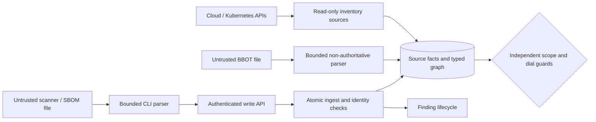

# Threat model: OSS inventory, collectors and assessments

## Scope and trust boundaries

Protect ownership decisions, finding history, cloud identity, credentials and
service availability. Actors are operators, authenticated report producers,
cloud/Kubernetes APIs and potentially malicious report content. Public API
authentication, write authorization, CSRF, body/rate/concurrency limits remain
unchanged. Report imports do not grant executable code or credential access.
Optional assessment execution is a separate operator-authorized boundary.

## STRIDE risk register

Scores use DREAD (damage, reproducibility, exploitability, affected users,
discoverability), each `1`–`5`. Owners are Deckard maintainers. Evidence maps to
the numbered execution tasks in [the platform plan](../oss-platform-plan.md).

| ID | Threat / STRIDE | Score | Mitigation and evidence | Status |
| --- | --- | --- | --- | --- |
| T1 | Report claims network ownership / spoofing, elevation | 5.0 | Artifact kinds are non-probeable; BBOT has no zones/owned attributes; scope/API/source tests; tasks 1, 6 | Mitigated |
| T2 | Partial data erases CVEs / tampering | 4.6 | Complete/newer/no-rejections gate; additive artifacts; independent SBOM producer; metadata-scope retention tests; tasks 2–4 | Mitigated |
| T3 | Cross-account ARN collision / spoofing | 4.0 | Full partition/account/region/resource equality; current authoritative facts; ambiguity refusal; tasks 5, 8 | Mitigated |
| T4 | Scanner report leaks secrets / disclosure | 3.8 | Native allowlists; no raw config/env/properties; URL/PURL credential refusal; redaction fixtures; tasks 1, 3, 6 | Mitigated, not universal redaction |
| T5 | Oversized report exhausts memory/DB / denial | 4.2 | 64 MiB local inputs, API 10 MiB, bounded nodes/edges/depth/events and existing API throttles; tasks 1–3, 6 | Mitigated |
| T6 | Missing provenance/audit trail / repudiation | 3.6 | Separate source facts, stable finding IDs, artifact-change events, replay tests; task 2 | Mitigated |
| T7 | Concurrent fact update defeats exact identity / tampering | 4.0 | Shared transaction advisory lock before inventory/ingest mutation; ambiguity and lock regressions; tasks 2, 5 | Mitigated |
| T8 | Scanner process escapes scope / elevation, disclosure | 5.0 | Dedicated non-root Jobs, no host socket/cloud identity, default deny, broker or exact IP/port grants, immutable images, deadlines and bounded IO | Mitigated in local contracts; live CNI proof required |
| T9 | Scanner success erases issues without full coverage / tampering | 4.8 | Runtime, restricted Kubescape, BBOT, ZAP and Strix remain incomplete; ZGrab2 stores observations only; failed runtime-image collection cannot upload | Mitigated |
| T10 | Producer token escalates to operator / elevation | 4.8 | Exact tool/scope/source grants; no inventory reads, UI or assessment actions; duplicate/admin-token refusal | Mitigated |
| T11 | Broker overload or lifecycle race / denial, tampering | 4.6 | 32 listener connections, 8 handlers/session, 4 CONNECT tunnels, upload reservation, cumulative budgets, drain before result acceptance, cancellation and UID-checked cleanup | Mitigated in race/integration tests |

## Critical attack paths

- Unauthorized scan: forge ownership in a report → create network target → bypass scope/dial guards. Imports cannot assert ownership; metadata kinds cannot be probed.
- False clean result: send empty/failed SBOM → impersonate Trivy → resolve CVEs. Native format/tool binding and separate producer lifecycle stop this path.
- Wrong-resource issue: reuse a name/partial ARN → race native facts → attach across accounts. Exact identities, ambiguity refusal and serialized ledger writes stop this path.

## Residual risks and deferred work

Operators remain responsible for report provenance and scanner success. JSON
syntax does not prove exhaustive vulnerability coverage. Allowed text can still
contain sensitive data; generic SARIF is not a credential-redaction format.
Review Strix reports before import and keep agentic assessments incomplete unless
independently justified. Agent-reported exploit success is not Deckard verification.

Artifact inventory is additive and needs a future provenance-aware retention
policy for long-lived deployments. Runtime config IDs, mutable tags and OCI index
digests cannot stand in for runtime manifest identity. Missing versions/PURLs and
unsupported Kubernetes ancestors remain explicit coverage gaps.

Database inventory/ingest mutations share a coarse advisory lock; network reads
do not. A local PostgreSQL16 race-enabled fixture completed `144` contending
transactions: `3200` finding updates and `800` inventory rows in `17.935s`.
With eight producers, one inventory writer and pool4, transaction p95 was `1.398s`.
This is regression evidence, not a production capacity guarantee. Keep bounded
collector concurrency; measure Marina latency before narrowing the identity lock.
Run `DECKARD_IDENTITY_LOAD=1 go test -race -v ./internal/store/postgres -run TestIdentityLockConcurrentLoad`
against the disposable testcontainer, never production data.

ZGrab2's direct fixed-IP grant lasts at most `15m`; ownership revocation is not
instantaneous, but final verification prevents clean coverage after revocation.
Stock ZAP disables client TLS verification. Strict Go preflights and broker target
TLS plus enforced CNI contain the supported boundary; they do not protect against
a compromised broker or CNI. Native ZAP scan timeout can be silent, so its reports
remain additive. Runtime event silence must not resolve incidents.

Strix uses genuine pinned upstream with a constrained HTTP/shell/filesystem adapter,
not unrestricted upstream feature parity. Model credentials stay in its controller;
runtime tools cannot reach the model gateway directly. Hosted LLMs require explicit
cost/data-egress approval. Turn limits do not impose a dollar budget. No live model
assessment or Marina CNI containment is claimed by local protocol fixtures.
See [the operating contract](collectors.md) for exact trust boundaries and gaps.

Review this model before adding a runnable collector, privileged sensor,
authenticated active scan or new artifact/identity authority.
