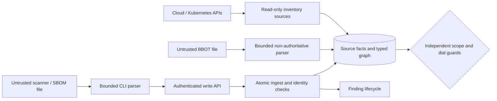

# Threat model: OSS inventory and report imports

## Scope and trust boundaries

Protect ownership decisions, finding history, cloud identity, credentials and
service availability. Actors are operators, authenticated report producers,
cloud/Kubernetes APIs and potentially malicious report content. Public API
authentication, write authorization, CSRF, body/rate/concurrency limits remain
unchanged. Reports do not grant executable code or credential access.

## STRIDE risk register

Scores use DREAD (damage, reproducibility, exploitability, affected users,
discoverability), each `1`–`5`. Owners are Deckard maintainers. Evidence maps to
the numbered execution tasks in [the platform plan](../oss-platform-plan.md).

| ID | Threat / STRIDE | Score | Mitigation and evidence | Status |
| --- | --- | --- | --- | --- |
| T1 | Report claims network ownership / spoofing, elevation | 5.0 | Artifact kinds are non-probeable; BBOT has no zones/owned attributes; scope/API/source tests; tasks 1, 6 | Mitigated |
| T2 | Partial data erases CVEs / tampering | 4.6 | Complete/newer/no-rejections gate; additive artifacts; independent SBOM producer; metadata-scope retention tests; tasks 2–4 | Mitigated |
| T3 | Cross-account ARN collision / spoofing | 4.0 | Full partition/account/region/resource equality; current authoritative facts; ambiguity refusal; tasks 5, 8 | Mitigated |
| T4 | Scanner report leaks secrets / disclosure | 3.8 | Native allowlists; no raw config/env/properties; URL/PURL credential refusal; redaction fixtures; tasks 1, 3, 6 | Mitigated, not universal redaction |
| T5 | Oversized report exhausts memory/DB / denial | 4.2 | 64 MiB local inputs, API 10 MiB, bounded nodes/edges/depth/events and existing API throttles; tasks 1–3, 6 | Mitigated |
| T6 | Missing provenance/audit trail / repudiation | 3.6 | Separate source facts, stable finding IDs, artifact-change events, replay tests; task 2 | Mitigated |
| T7 | Concurrent fact update defeats exact identity / tampering | 4.0 | Shared transaction advisory lock before inventory/ingest mutation; ambiguity and lock regressions; tasks 2, 5 | Mitigated |
| T8 | Scanner process escapes scope / elevation, disclosure | 5.0 | No BBOT/Trivy/Strix/ZGrab2/ZAP subprocess runner in this release; task 8 | Eliminated from this release |

## Critical attack paths

- Unauthorized scan: forge ownership in a report → create network target → bypass scope/dial guards. Imports cannot assert ownership; metadata kinds cannot be probed.
- False clean result: send empty/failed SBOM → impersonate Trivy → resolve CVEs. Native format/tool binding and separate producer lifecycle stop this path.
- Wrong-resource issue: reuse a name/partial ARN → race native facts → attach across accounts. Exact identities, ambiguity refusal and serialized ledger writes stop this path.

## Residual risks and deferred work

Operators remain responsible for report provenance and scanner success. JSON
syntax does not prove exhaustive vulnerability coverage. Allowed text can still
contain sensitive data; generic SARIF is not a credential-redaction format.
Review Strix reports before import and keep agentic assessments incomplete unless
independently justified. Agent-reported exploit success is not Deckard verification.

Artifact inventory is additive and needs a future provenance-aware retention
policy for long-lived deployments. Runtime config IDs, mutable tags and OCI index
digests cannot stand in for runtime manifest identity. Missing versions/PURLs and
unsupported Kubernetes ancestors remain explicit coverage gaps.

Database inventory/ingest mutations share a coarse advisory lock; network reads
do not. High ingestion throughput needs load testing before replacing that lock
with a narrower persisted identity design. No schema migration is required now.

ZGrab2, Falco, ZAP and Strix runners remain separate milestones. They require
enforced egress, isolated credentials, explicit target authorization and bounded
runtime. Runtime event silence must not resolve incidents. Hosted LLMs additionally
require a budget and explicit data-egress policy.

Review this model before adding a runnable collector, privileged sensor,
authenticated active scan or new artifact/identity authority.
